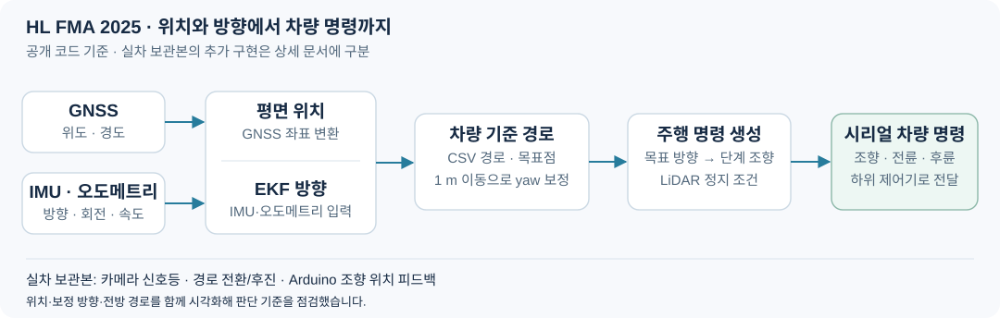

# HL FMA 2025 · GPS 경로 기반 자율주행

유아용 전동차를 개조해 센서를 탑재하고, 지도 경로와 차량의 위치·방향을 실제 조향·구동 명령으로 연결한 프로젝트입니다. 초기 방향 보정부터 경로 추종, 미션 상태 전환, Arduino 하위 제어까지 통합해 **HL FMA 2025 자율주행 경진대회 장려상**을 수상했습니다.

`ROS 2 Humble` · `Python` · `GNSS` · `IMU / EKF` · `LiDAR` · `Arduino` · `HENES-T870`

## 시스템 흐름

GNSS 위치와 EKF 방향으로 차량 기준 경로를 만들고, 목표점 방향을 조향·구동 명령으로 바꿉니다. 실차 개발에서는 카메라 신호등 상태, 다중 경로 선택, 전진·후진 전환과 하위 조향 피드백을 추가했습니다. **공개 코드와 실차 보관본의 차이**는 [구현 구성 문서](docs/technical-notes.md)에 구분했습니다.

## 개발 현장

[개조 차량·탑재 노트북 사진 1](assets/competition-1.jpg) · [현장 사진 2](assets/competition-2.jpg) · [사진 안내](docs/demo.md)

실차 주행 영상은 보유하고 있지 않아, 차량 구성 사진과 구현·개발 기록으로 정리했습니다.

## 핵심 구현

### 1. 실제 이동으로 초기 방향 정렬

위치가 맞아도 초기 yaw가 어긋나면, 차량 앞의 경로가 옆에 있는 것처럼 계산됐습니다. 출발 후 **GPS 위치가 1 m 이동할 때의 벡터**를 방향 기준으로 삼고, EKF yaw와의 차이를 오프셋으로 저장했습니다. 이후 경로 계산에 같은 보정을 적용하고, 실차 보관본에서는 초기화 상태를 구동 계층에도 전달했습니다.

### 2. 지도 좌표를 조향 명령까지 연결

GNSS 위치와 CSV 경로에 같은 좌표 변환 기준을 적용했습니다. 차량 기준 축을 **오른쪽 +x, 전방 +y**로 정의하고, 목표 방향 계산과 조향 부호를 맞췄습니다. 상위 조향 단계를 Arduino의 포텐시오미터 목표값으로 연결해 기구의 실제 위치를 제어했습니다.

### 3. 미션 상태와 관측 경로 구성

실차 보관본에서 구간별 신호등·LiDAR 조건, 경로 끝 대기, 다음 경로 선택과 전진·후진 전환을 관리했습니다. 현재 위치·보정 방향·전방 경로를 함께 시각화해 **차량이 어떤 정보를 바탕으로 조향하는지** 확인할 수 있게 했습니다.

## 결과와 검증

| 항목 | 확인한 내용 |
|---|---|
| 대회 성과 | **장려상** · 팀 KHUsla · 2025.11.04 수상 |
| 차량 통합 | 개조 차량, 센서 입력, ROS 2 주행 판단, 시리얼 명령과 Arduino 제어 연결 |
| 방향·경로 점검 | 보정 yaw, 현재 위치, 방향 화살표, 전방 경로를 같은 화면에서 관찰 |
| 기록과 재현 | 경로계획 로그, 좌표 규약, 공개 코드·실차 보관본의 설정 차이 정리 |

초기 방향 문제를 센서 값만으로 다루지 않고, 실제 이동과 초기화 동작을 연결해 해결했습니다. 경로계획에서 사용하는 방향을 시각화에도 적용해 디버깅 기준을 일치시켰습니다.

## 문서와 코드

- [개발 과정과 문제 해결](docs/development-notes.md): 방향 보정, 좌표 통합, 미션과 하위 제어
- [구현 구성과 설정](docs/technical-notes.md): 공개 코드·실차 보관본 비교, 메시지와 주요 설정
- [핵심 코드 안내](docs/code-map.md): 설계 설명과 연결되는 소스 파일
- [팀 원본 저장소](https://github.com/Khusla/HLFMA_2025)

[대표 프로젝트 목록으로 돌아가기](https://github.com/jounget5411-lab/portfolio)
