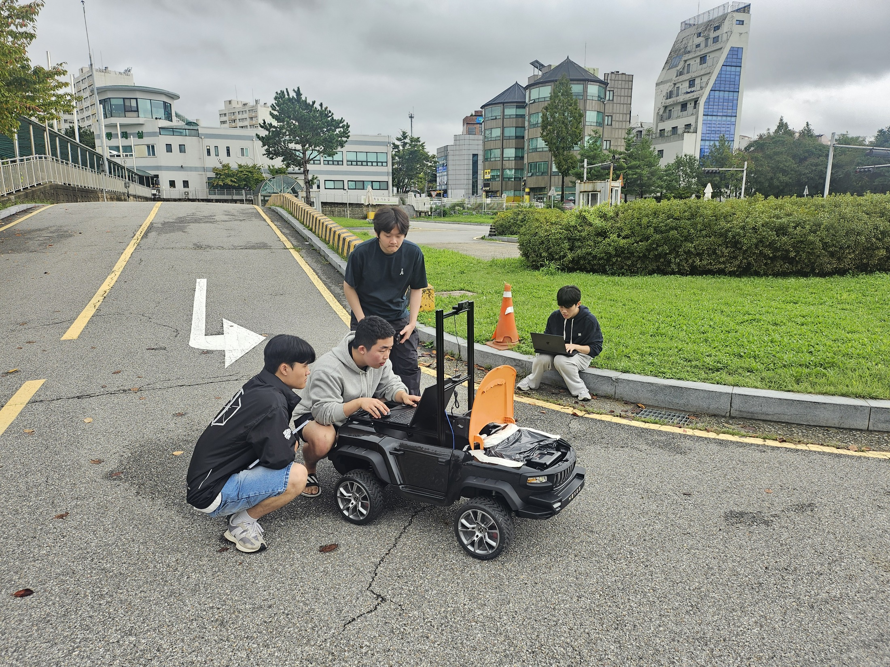
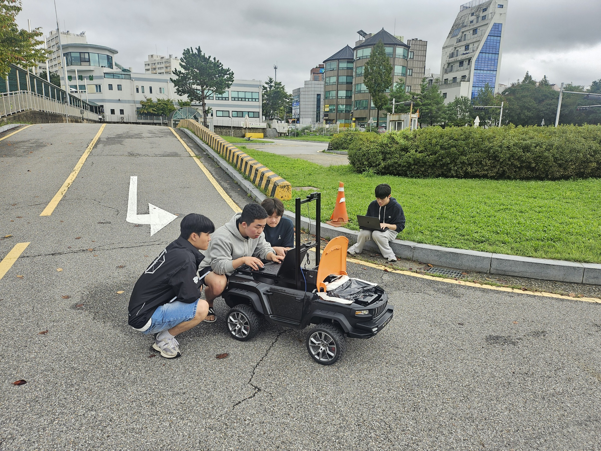

# 실제 차량 개발 현장

[프로젝트 소개](../README.md) · [개발 과정과 문제 해결](development-notes.md) · [구현 구성과 설정](technical-notes.md)

HL FMA 2025의 개조 차량과 탑재 노트북을 함께 살펴보는 야외 개발 현장입니다. 사진을 누르면 원본 크기로 볼 수 있습니다.

GPS 위치·차량 방향·경로를 조향과 구동 명령으로 연결한 구성과, 초기 방향 보정 과정은 [개발 과정 문서](development-notes.md)에 정리했습니다.
